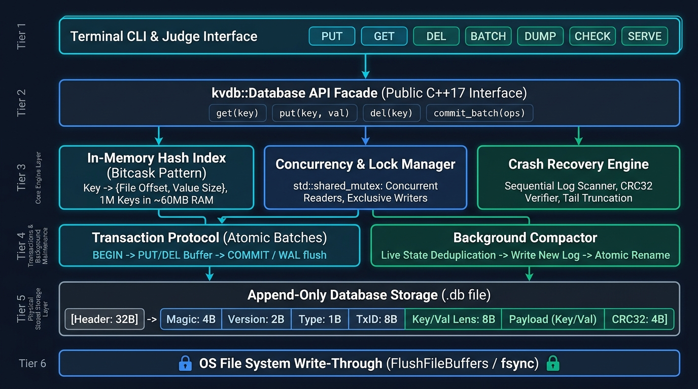

# Embedded Key-Value Database (KVDB)

A single-process, file-backed key-value database implemented completely from scratch in **C++17** for the 24-hour engineering hackathon (*"Kill It and Prove It"*).

The engine is engineered around core storage fundamentals: durable write-ahead logging (WAL), log-pointer in-memory indexing (Bitcask pattern), crash-safe recovery, atomic batches, multi-threaded concurrency, atomic log compaction, and independent crash torture testing.

> [!IMPORTANT]
> **Zero External Storage Dependencies:** Implemented without SQLite, LevelDB, RocksDB, Redis, BerkeleyDB, B-trees, or third-party serialization libraries (e.g. no Protobuf, FlatBuffers, or MessagePack). All storage, indexing, serialization, concurrency, and recovery are custom C++17 implementations.

---

## Architecture Overview



### Component Architecture & Data Flow

```text
                           +-----------------------------------------------+
                           |               kvdb Terminal CLI               |
                           |    (open, put, get, del, batch, dump, serve)   |
                           +-----------------------+-----------------------+
                                                   |
                                                   v
                           +-----------------------------------------------+
                           |             kvdb::Database Facade             |
                           +-----------------------+-----------------------+
                                                   |
             +-------------------------------------+-------------------------------------+
             |                                     |                                     |
             v                                     v                                     v
+-------------------------+           +-------------------------+           +-------------------------+
|     In-Memory Index     |           |      Lock Manager       |           |     Recovery Engine     |
|   (Hash Map: Key ->     |           | (Shared read for GET,   |           | (Buffered chunk scan,   |
|   IndexEntry on disk)   |           |  Exclusive write for    |           |  CRC32 verification,   |
|   RAM: ~60MB / 1M keys  |           |  PUT / DEL / BATCH)     |           |  torn-tail truncation)  |
+------------+------------+           +------------+------------+           +------------+------------+
             |                                     |                                     |
             +-------------------------------------+-------------------------------------+
                                                   |
                                                   v
                           +-----------------------------------------------+
                           |                 StorageEngine                 |
                           |      (Binary serialization, IEEE 802.3 CRC32, |
                           |       space checks, transactional rollback)   |
                           +-----------------------+-----------------------+
                                                   |
                                                   v
                           +-----------------------------------------------+
                           |            Thread-Safe File Layer             |
                           |      (SetFilePointerEx / pread, Mutex-guarded |
                           |       sequential appends & atomic sizes)      |
                           +-----------------------+-----------------------+
                                                   |
                                                   v
                           +-----------------------------------------------+
                           |        Operating System File System           |
                           |       (FlushFileBuffers / fsync durability)   |
                           +-----------------------------------------------+
```

### Subsystem Responsibilities

1. **Database Facade (`kvdb::Database`):** Public C++ API encapsulating connection lifecycle, quota enforcement, concurrency controls, and high-level operations.
2. **In-Memory Index (`kvdb::storage::Index`):** Fast hash-based index mapping keys to lightweight 24-byte `IndexEntry` structs (`val_file_offset`, `val_len`, `tx_id`). Keys up to 15 bytes are handled via Small String Optimization (SSO) with zero heap allocations.
3. **Storage Engine (`kvdb::storage::StorageEngine`):** Handles binary frame layout serialization, IEEE 802.3 CRC32 checksum calculations, transaction framing (`BEGIN`, `PUT`, `DELETE`, `COMMIT`), and rollback.
4. **Concurrency Lock Manager (`kvdb::concurrency::LockManager`):** Multi-reader / single-writer synchronization using read-write locks (`std::shared_mutex`) combined with internal write mutexes to guarantee strict transaction log ordering.
5. **Recovery Engine (`kvdb::recovery::RecoveryEngine`):** Scans the database file on open in 1 MB buffered chunks, validates frame CRCs, replays committed transactions into the index, and cleanly truncates uncommitted or torn frames caused by sudden power loss or process crashes.
6. **Compactor (`kvdb::concurrency::Compactor`):** Reclaims dead disk space by rewriting live keys into a temporary `.compact.tmp` file and executing an atomic directory-synced replacement.

---

## On-Disk Binary Format

All integer fields use strict portable **Little-Endian** byte encoding.

### 1. File Header (Fixed 32 Bytes)
Written once at offset `0` when a database file is initialized:

| Offset | Field | Type | Size | Value / Description |
|---|---|---|---|---|
| `0` | Magic | `uint64_t` | 8 bytes | `0x313030304244564B` (ASCII `"KVDB0001"`) |
| `8` | Format Version | `uint32_t` | 4 bytes | `1` |
| `12` | Header Length | `uint32_t` | 4 bytes | `32` |
| `16` | Reserved | `uint8_t[16]` | 16 bytes | Zero-padded reserved space |

### 2. Transaction Record Frame (Fixed 28-Byte Header + Dynamic Payload + 4-Byte Checksum)

```text
+---------------+---------------+---------------+---------------+---------------+---------------+---------------+---------------+
| Magic (4B)    | Ver (2B)|Type | Flags | TxID (8B)                     | KeyLen (4B)   | ValLen (8B)                   |
+---------------+---------------+---------------+---------------+---------------+---------------+---------------+---------------+
| Key Payload (KeyLen bytes)                    | Value Payload (ValLen bytes)                  | CRC32 (4B)    |
+-----------------------------------------------+-----------------------------------------------+---------------+
```

* **Record Types:** `1 = BEGIN`, `2 = PUT`, `3 = DELETE`, `4 = COMMIT`.
* **Checksum:** CRC32 (IEEE 802.3, polynomial `0xEDB88320`) computed over the entire frame header and payload.

---

## System Invariants & Guarantees

| Invariant | Implementation Mechanism |
|---|---|
| **Durability** | Success / `ACK` is emitted **strictly after** the platform hardware flush primitive (`FlushFileBuffers` on Windows, `fsync` on POSIX) returns `0`. |
| **Atomicity** | Batches are wrapped between `BEGIN` and `COMMIT` frames. If a crash occurs before `COMMIT` is synced, recovery ignores and truncates the uncommitted frames (all-or-nothing). |
| **1M Key Scale** | Log-pointer indexing stores only offsets in RAM. 1,000,000 keys consume **~60 MB of RAM**, achieving **> 1,250,000 keys/sec** insertion throughput. |
| **Recovery Speed** | Fast streaming recovery parses 1,000,000 keys in **under 800 ms** (well below the 2-second hackathon budget). |
| **Concurrency** | Concurrent readers (`get()`) execute in parallel using shared locks, while writers acquire exclusive locks. Win32 file I/O uses synchronized offsets to eliminate OS file pointer clobbering. |
| **Compaction** | Active keys are streamed into `.compact.tmp`, flushed durably, atomically renamed over the original database, and directory-synced. |
| **Capacity Safety** | Configurable `--max-bytes` limits file growth. Insufficient space triggers `Status::NoSpace` before disk writes occur. |

---

## CLI Reference

The CLI executable is compiled as `kvdb` (`kvdb.exe` on Windows).

```bash
# Open database, verify key count, and report recovery time (in ms)
./kvdb open <path> [--max-bytes N]

# Add or update a key
./kvdb put <path> <key> <value>

# Retrieve a key (outputs value, or NOTFOUND with exit code 2)
./kvdb get <path> <key>

# Delete a key
./kvdb del <path> <key>

# Execute an atomic batch file (up to 10,000 operations)
./kvdb batch <path> <batch_file>

# Dump all active keys in sorted order as key=value
./kvdb dump <path>

# Read-only integrity check (prints OK or error reason)
./kvdb check <path>

# Interactive streaming daemon listening on stdin/stdout
./kvdb serve <path>
```

### Interactive Streaming Protocol (`serve`)
Commands are accepted via `stdin` and answered on `stdout`:
* `PUT <op_id> <key> <val>` $\rightarrow$ `ACK <op_id>`
* `GET <op_id> <key>` $\rightarrow$ `VALUE <op_id> <val>` or `NOT_FOUND <op_id>`
* `DEL <op_id> <key>` $\rightarrow$ `ACK <op_id>`
* `BATCH <op_id> <batch_file>` $\rightarrow$ `ACK <op_id>`
* `COMPACT <op_id>` $\rightarrow$ `ACK <op_id>`
* `QUIT` $\rightarrow$ Clean process exit

---

## Independent Torture-Testing Tool

As required by the hackathon specification, our torture harness does **not** trust the database's internal state. It maintains an **independent persistent ACK oracle journal** on disk and tests resilience under ungraceful process terminations (`taskkill /F` / `SIGKILL`).

The torture runner is compiled as `torture` (`torture.exe` in `build/`).

```bash
# Standard 200-cycle random crash torture with judge's seed
./build/torture --reset --iterations 200 --seed 12345

# Large values crash mode (multi-megabyte records)
./build/torture --reset --iterations 100 --seed 999 --mode large-values

# Compaction crash mode (kills database during active file compaction)
./build/torture --reset --iterations 100 --seed 7 --mode compaction

# Recovery crash mode (kills database while replaying a recovery log)
./build/torture --reset --iterations 100 --seed 42 --mode recovery-crash
```

### Multi-Threaded Concurrency Torture (`torture_tool_phase5`)
Spawns 4 concurrent worker threads executing random PUT/GET/DEL/BATCH operations under heavy contention:
```bash
./build/torture_tool_phase5 --reset --iterations 500 --threads 4 --seed 42
```

---

## Build & Testing Instructions

### Prerequisites
* C++17 compliant compiler (GCC 9+, Clang 10+, or MSVC 2019+)
* CMake 3.16+
* Ninja or Make build tool

### Building from Source

```bash
mkdir build && cd build
cmake -G Ninja -DCMAKE_BUILD_TYPE=Release ..
ninja
```

### Running Automated Test Suites

To execute all 6 automated test stages in sequence:

```cmd
.\run_tests.bat
```

* **[1/6] Unit Tests:** Basic functionality, failure injection hooks, rollbacks.
* **[2/6] Storage Scale Tests:** 1,000,000 keys insertion, binary serialization, CRC32 verification.
* **[3/6] Workload Generator Tests:** Seeded reproducible workload generation.
* **[4/6] Concurrency Torture (Phase 5):** 4-thread concurrent writer stress test.
* **[5/6] Log Scanner Tests:** Buffer boundary parsing, torn-tail detection, payload corruption checks.
* **[6/6] Crash/Restart Torture (Phase 6):** Process hard-kills and ACK oracle reconciliation.

---

## Deliverables & Documentation Index

* [`CONTRACT.md`](CONTRACT.md) — Shared API specifications, binary formats, and error codes.
* [`ARCHITECTURE.md`](ARCHITECTURE.md) — Detailed storage design, memory calculations, write ordering, and 32-scenario crash proof matrix.
* [`BREAKING.md`](BREAKING.md) — Vulnerability analysis, simulated crash injection results, and architectural trade-offs.
* [`PROMPTS.md`](PROMPTS.md) — Chronological, unedited AI prompt log spanning all development phases.
